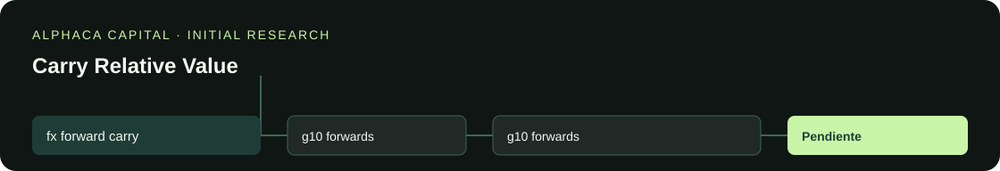

# Informe inicial · Carry Relative Value · 2026-11-20

**Estado de la corrida:** revisión cualitativa completa.  
**Motores por rol:** literatura: codex/gpt-6-luna/high (ChatGPT OAuth), datos: codex/gpt-6-luna/high (ChatGPT OAuth), red_team: codex/gpt-6-luna/high (ChatGPT OAuth).  
**Alcance:** investigación cualitativa y revisión documental; esta corrida no leyó precios ni ejecutó backtests.

## Resumen ejecutivo

Este informe organiza revisión de literatura, diagnóstico de datos y crítica independiente. No presenta rentabilidades medidas ni declara un edge validado. La cobertura y los huecos de datos siguen desconocidos hasta calcularlos contra un calendario de sesiones verificado; las gates estadísticas, de robustez y costos siguen pendientes.

## Árbol de investigación

## Hipótesis existentes

- `fx_forward_carry/g10_forwards/hypothesis.md` — veredicto: pendiente de datos y gates.

## Gates

| Gate | Estado |
|---|---|
| Calidad/cobertura de datos | Pendiente; no recalculada en esta corrida |
| Estadística fuera de muestra | Pendiente; sin backtest |
| Robustez | Pendiente; sin backtest |
| Costos/spreads/swaps | Pendiente; sin backtest |
| Aprobación de edge | No confirmado |

## Literatura y mecanismo económico

*Motor:* `codex/gpt-6-luna/high (ChatGPT OAuth)`

# Literatura y mecanismo · Carry y valor relativo

**Corte de literatura:** publicaciones anteriores a 2018.  
**Estado:** síntesis bibliográfica; no valida una estrategia ni un retorno en los datos de Alphaca.

## Mecanismos que conviene distinguir

- **Carry FX:** una cartera compra monedas con mayor descuento forward y financia la posición con monedas con menor descuento. El retorno combina el movimiento spot con el diferencial forward o la financiación. Ese diferencial puede compensar riesgo cambiario, de liquidez y de financiación; no es arbitraje sin riesgo. Una posición aislada en USDJPY no equivale a una cartera transversal de monedas.
- **Carry y basis de commodities:** la curva de futuros, los inventarios y el rendimiento de conveniencia pueden relacionarse con primas de riesgo. El signo y la magnitud pueden variar por commodity y vencimiento. Una serie continua o un CFD spot no identifica por sí solo el basis ni el retorno de roll negociable.
- **Valor relativo y pares:** una posición larga y otra corta puede beneficiarse si existe una relación económica estable y el spread revierte. La correlación o la cointegración estimada dentro de una muestra no garantiza que la relación perdure ni que la operación cubra costos y financiación.

## Trabajos académicos anteriores a 2018

- **Eugene F. Fama (1984), “Forward and Spot Exchange Rates.”** Condicional a un mercado forward racional o eficiente, encuentra que el diferencial forward-spot varía en el tiempo y que gran parte de la variación del forward en su muestra corresponde a la prima. Esto advierte que el forward no debe interpretarse como pronóstico puro del spot; no demuestra que una regla retail sea rentable. [DOI y artículo en *Journal of Monetary Economics*](https://doi.org/10.1016/0304-3932(84)90046-1). citeturn1search3
- **Hanno Lustig, Nikolai Roussanov y Adrien Verdelhan (2011), “Common Risk Factors in Currency Markets.”** Sus carteras ordenadas por tasas de interés identifican un factor de pendiente asociado con la variación transversal de los retornos excedentes; los autores relacionan ese factor con shocks comunes y volatilidad global. Motiva estudiar el riesgo compartido entre monedas, pero no valida un par aislado ni un CFD. [DOI y artículo en *The Review of Financial Studies*](https://doi.org/10.1093/rfs/hhr068). citeturn0search0
- **Lukas Menkhoff, Lucio Sarno, Maik Schmeling y Andreas Schrimpf (2012), “Carry Trades and Global Foreign Exchange Volatility.”** Estudian carteras de carry FX y relacionan sus retornos con la volatilidad global de divisas. El trabajo motiva medir resultados en estados de volatilidad adversa; no determina las condiciones de financiación de un broker concreto. [DOI y artículo en *The Journal of Finance*](https://doi.org/10.1111/j.1540-6261.2012.01728.x). citeturn0search1
- **Markus K. Brunnermeier, Stefan Nagel y Lasse H. Pedersen (2009), “Carry Trades and Currency Crashes.”** Documentan asimetría negativa en retornos de carry y argumentan que los desarmes abruptos, cuando caen el apetito por riesgo y la liquidez de financiación, son un mecanismo compatible con ese riesgo. Es una razón para evaluar colas y liquidez, no una estimación del riesgo de una cuenta local. [DOI y versión publicada, *NBER Macroeconomics Annual*](https://doi.org/10.1086/593088). citeturn1search2
- **Gary B. Gorton, Fumio Hayashi y K. Geert Rouwenhorst (2013), “The Fundamentals of Commodity Futures Returns.”** Con futuros de 31 commodities e inventarios físicos, documentan una relación no lineal entre inventarios y rendimiento de conveniencia; medidas como el basis contienen información sobre primas en los datos estudiados. Esto respalda probar curvas e inventarios por separado, no inferir carry de un CFD o una serie continua. [DOI y artículo en *Review of Finance*](https://doi.org/10.1093/rof/rfs019). citeturn0search2
- **Marta Szymanowska, Frans de Roon, Theo Nijman y Rob van den Goorbergh (2014), “An Anatomy of Commodity Futures Risk Premia.”** Separan primas spot y primas de término relacionadas con cambios en el basis. El resultado motiva no condensar toda la rentabilidad de futuros en una única medida de “carry”; no confirma rentabilidad tras los costos de roll de otro mercado. [DOI y artículo en *The Journal of Finance*](https://doi.org/10.1111/jofi.12096). citeturn1search1
- **Evan Gatev, William N. Goetzmann y K. Geert Rouwenhorst (2006), “Pairs Trading: Performance of a Relative-Value Arbitrage Rule.”** Prueban una regla de selección de pares por distancia entre trayectorias de precios normalizadas en acciones estadounidenses. Su evidencia histórica depende de ese universo, diseño y periodo; no demuestra que los instrumentos del repositorio sean sustitutos estables ni que una estrategia local sobreviva a costos actuales. [DOI y artículo en *The Review of Financial Studies*](https://doi.org/10.1093/rfs/hhj020). citeturn1search0

## Predicciones falsables y preguntas abiertas

1. **FX carry transversal:** con universo G10 definido *point-in-time*, forward points o tasas disponibles al decidir, y costos negociables, ¿la cartera long de mayor descuento forward y short de menor descuento obtiene retorno neto positivo fuera de muestra? ¿Se concentra su riesgo en estados de volatilidad o desarme? La ficha existente sigue como `data_pending`: el spot USDJPY por sí solo no permite este test.
2. **Basis de commodities:** ¿la curva por vencimiento y los inventarios disponibles contemporáneamente predicen retornos futuros por separado del movimiento spot? Hace falta una regla de roll fijada de antemano y contratos individuales; el CFD de petróleo o una serie ajustada no basta para responder.
3. **Pares:** ¿un spread entre instrumentos predefinidos revierte fuera de muestra con hedge ratio calculado solo con información pasada, timestamps sincronizados y costos de ambos lados? ¿Se mantiene la relación al cambiar de ventana o régimen?
4. **Financiación real:** ¿forward points, swaps, rollovers, borrow y demás costos históricos corresponden al instrumento y proveedor que se podrían negociar? Sin esas series, una señal de precio no mide el retorno total.

La literatura ofrece mecanismos y resultados para muestras y construcciones específicas. No prueba un edge en Alphaca: aquí no se han verificado forward points, swaps históricos, curvas de contratos ni costos, y no se han ejecutado pruebas. Las hipótesis de esta familia siguen pendientes hasta contar con esos datos y evaluarlas fuera de muestra.

## Evidencia empírica y datos

*Motor:* `codex/gpt-6-luna/high (ChatGPT OAuth)`

# Informe de evidencia y datos · carry y valor relativo

**Fecha UTC:** 2026-11-20  
**Estado:** no se verificó un conjunto de datos ejecutable para ninguna pauta de la familia. No se leyeron series CSV de mercado, no se descargaron ni interpolaron datos y no se calculó cobertura en esta corrida. La ficha de forwards G10 continúa en `data_pending`.

## Qué está descrito y qué se verificó

**Descrito en los archivos de la familia:** hay referencias a históricos Axi de USDJPY y EURGBP, series de petróleo rotuladas USOIL/WTIFS y XTIUSD de Axi o Darwinex, y colecciones Mongo para ES/NQ/6E/6J. No se localizaron forward points G10, swaps históricos, curvas de futuros por vencimiento, inventarios ni costes de financiación. Esas referencias identifican candidatos, no validan un edge ni su disponibilidad en una cuenta.

**Verificado en esta corrida:** se revisaron los archivos de auditoría e inventario del repositorio, sin abrir los CSV de mercado. El manifiesto existente registra ventanas nominales, marcas temporales y algunos controles básicos de formato para varias series. A la vez, deja la procedencia sin verificar, la cobertura sin calcular y la zona horaria de los CSV etiquetados Axi/Darwinex como desconocida. No revalidé esos metadatos contra los archivos originales.

El manifiesto registra, por ejemplo, USDJPY M5 de Axi con fechas nominales 2000-01-02 a 2026-11-03, EURGBP M5 de Axi de 2017-01-02 a 2026-11-06, WTIFS H1 de 2008-02-18 a 2026-11-02 y XTIUSD H1 de Darwinex de 2010-05-02 a 2026-11-02. Las fechas son ventanas nominales del inventario; **no demuestran cobertura continua**. El control anterior cuenta huecos brutos mayores a cuatro días naturales en orden de archivo, pero no contrasta sesiones ni festivos. Un conteo cero no demuestra continuidad; un conteo positivo requiere investigar el tramo.

| Instrumento o candidato | Evidencia local del inventario | Limitación para carry/valor relativo |
|---|---|---|
| FX USDJPY / EURGBP | CSV M5 etiquetados Axi; USDJPY también tiene una serie M5 Darwinex de ventana nominal mucho más corta. | Spot no aporta forward points, financiación ni swaps históricos. Proveedor, zona horaria, sesiones, spread ejecutable y especificación no están confirmados. USDJPY aislado tampoco constituye una cartera transversal G10. |
| Petróleo WTIFS / USOIL / XTIUSD | CSV H1 etiquetados Axi/Darwinex, con ventanas nominales largas. | Los nombres no prueban si son CFDs, qué subyacente replican ni qué ajustes/rollover aplican. No se identificó una cadena de contratos con vencimientos negociables; no se puede inferir basis de futuros de una serie spot/CFD. |
| Futuros ES/NQ/6E/6J | Notebooks EDA mencionan colecciones Mongo como `es_15min`, `nq_15min`, `6e_15min` y `6j_15min`. | No se consultó Mongo ni se identificaron proveedor, contrato, calendario, settlement, reglas de roll o financiación. |
| Pares/acciones/ETF | Hay referencias generales a QQQ y a datos de acciones en otros análisis del repositorio. | No se verificó un universo de pares definido para esta familia ni datos sincronizados con dividendos, borrow, financiación y costes de ambos lados. |

## Fuentes prioritarias y datos faltantes

1. **FX forwards G10:** primero, datos históricos point-in-time de spot y forward points bid/ask para un universo y fixing definidos, idealmente de un proveedor ejecutable o institucional con metadatos de timestamp y settlement. Como comprobación independiente, conservar tasas oficiales de cada moneda con hora de publicación; esas tasas pueden servir para contraste, pero no reemplazan forwards observados ni los swaps de un CFD. Faltan además universo G10 point-in-time, calendarios de settlement y festivos, coste por lado, rollover y slippage.
2. **CFD FX del broker:** obtener especificaciones del símbolo y el historial de swaps/financiación por lado y fecha, incluidos días de cargo múltiple, cambios de condiciones y calendario de rollover. Añadir cotizaciones bid/ask o spreads históricos y comisiones de la cuenta. No imputar forward points institucionales como si fueran financiación retail.
3. **Basis de futuros de commodities:** identificar primero el subyacente, venue y contrato exactos detrás de WTIFS/USOIL/XTIUSD. Después obtener settlements y cotizaciones por vencimiento, especificaciones, volumen/liquidez, regla de roll fijada ex ante y costes de ejecución. Para investigar inventarios, añadir una serie histórica de fuente primaria con fecha de publicación y vintage disponible entonces. Un CFD aislado no cierra este requisito.
4. **Futuros ES/NQ/6E/6J:** documentar el origen y esquema de las colecciones, contratos individuales, zona horaria, calendario de sesión, settlement y roll. Si no se accede a Mongo, la disponibilidad de esas series queda pendiente.
5. **Pares/valor relativo:** fijar instrumentos y universo antes del test; obtener precios sincronizados bid/ask, timestamps y divisas, junto con dividendos, borrow, financiación, vencimientos y costes de ambos legs. No hay evidencia local verificada de que las parejas candidatas tengan datos suficientes para una prueba de esta familia.

## Plan mínimo reproducible

Para cada pauta, guardar un manifiesto versionado con proveedor, instrumento y contrato, licencia/forma de adquisición, granularidad, timezone IANA y convención DST, sesión y calendario, primera y última observación, fecha de descarga, ajustes, campos disponibles y costes. Conservar timestamps originales y normalizados a UTC; no unir series por fecha sin verificar cuándo estaba disponible cada dato.

Definir antes de medir cobertura el calendario esperado de cada instrumento y granularidad. Comparar observaciones contra ese calendario para calcular cobertura, huecos de sesión, duplicados, timestamps fuera de orden y barras ausentes; investigar los huecos antes de cualquier backtest. El valor de cobertura sigue **desconocido** hasta ese cálculo. No rellenar ausencias.

Comparar feeds en un tramo solapado y horario común, usando timestamps y cotizaciones compatibles. Registrar por separado diferencias de sesión, spread, bid/ask, precios, roll, swaps y especificaciones; no empalmar feeds para presentar una historia única. Si una conclusión depende de una serie sustituta, ajustada o empalmada, etiquetarla **NO CONFIRMADO** y reportar los tramos y resultados por feed.

Para G10, el paquete mínimo debe incluir moneda base, universo point-in-time, fixing, maturities, retornos spot y forward/funding, costes, calendarios y momento de disponibilidad de cada input. Para futuros, debe contener contratos por vencimiento y la regla de roll reproducible. Para pares, debe incluir timestamps sincronizados y todos los flujos/costes de los dos legs.

## Evidencia necesaria antes de pasar a notebook

Puede prepararse un notebook de **auditoría de datos** cuando estén definidos los instrumentos, el calendario esperado y los archivos con procedencia y timestamps documentados. Para pasar a un notebook de estrategia, la evidencia mínima es: cobertura calculada de al menos 98% según el gate común; costes y financiación históricos aplicables; fuentes point-in-time; y conciliación de diferencias entre feeds. La hipótesis de forwards G10 requiere forwards/forward points o una convención de tasas documentada y disponible en cada fecha; spot M5 de USDJPY por sí solo no basta.

Aun si se completa ese paquete, los gates estadísticos, de muestra, robustez, costes estresados y ventanas fuera de muestra siguen pendientes. No se ejecutaron backtests ni se identificaron casos casi-pasa.

## Crítica independiente / red team

*Motor:* `codex/gpt-6-luna/high (ChatGPT OAuth)`

# Red team · Carry transversal en forwards G10

**Estado:** revisión crítica de la ficha; no se ejecutaron pruebas ni se verificaron datos. **Veredicto:** pendiente (`data_pending`). La pregunta es falsable en principio, pero la construcción de cartera y el retorno negociable aún no están definidos con suficiente precisión para reproducirla.

## Objeciones

| Severidad | Objeción | Prueba para refutarla |
|---|---|---|
| **Bloqueante** | **La cartera no está especificada.** “Mayor forward discount” no fija la cotización usada, el signo de la señal, la moneda base, los grupos long/short, la ponderación, el apalancamiento ni el horizonte de tenencia. Distintas convenciones pueden invertir o cambiar sustancialmente el resultado. | Escribir la señal, el retorno por moneda, la unidad de cuenta, las reglas de ranking y de rebalanceo como fórmulas; reproducirla desde cotizaciones fuente. Confirmar que una implementación independiente produce las mismas posiciones y PnL. |
| **Bloqueante** | **No hay datos que acrediten que el retorno sea ejecutable.** La ficha reconoce que el repositorio no identifica forwards ni forward points. Spot y tasas sueltas no sustituyen cotizaciones forward negociables; una estimación teórica puede diferir por basis, fixing, fechas de valor, spreads y financiación. | Obtener spot y forwards bid/ask point-in-time para el universo, junto con calendarios, settlement y costos. Conciliar el PnL calculado con cotizaciones ejecutables. Si solo hay tasas o spot/CFD, mantener la pauta pendiente. |
| **Alto** | **Riesgo de look-ahead en señal y ejecución.** La fecha de observación no demuestra que forward points, tasas y fixings estuvieran disponibles al momento de formar la cartera. | Conservar timestamps de publicación y captura; formar posiciones solo con información ya disponible y ejecutar después de la señal. Repetir con retardos conservadores. Descartar si la rentabilidad depende de información posterior al fill. |
| **Alto** | **Universo y supervivencia no están definidos.** “G10” puede referirse a convenciones distintas y no especifica monedas, calendario de inclusión ni tratamiento de cambios estructurales, como la introducción del euro. Excluir monedas o periodos problemáticos a posteriori puede sesgar el resultado. | Fijar el universo y las reglas de elegibilidad antes de medir retornos. Reconstruirlos punto por punto en el tiempo, documentar exclusiones y reportar sensibilidad a definiciones alternativas preespecificadas. |
| **Alto** | **El retorno neto está descrito, pero no construido.** No se separan PnL spot, forward, financiación y ejecución ni se especifican convenciones de moneda, bid/ask, roll, comisión o slippage. | Descomponer el retorno por componente y conciliar cada uno contra contratos y cotizaciones. Aplicar costos históricos por moneda, lado y fecha; reportar también estrés de costos 2×. |
| **Alto** | **Riesgo de cola y dependencia de régimen.** La exposición a volatilidad global y unwind está mencionada, pero no se fijan estados, métricas ni límites. Un promedio positivo podría ocultar pérdidas concentradas, gaps o liquidaciones. | Predefinir métricas de drawdown, cola, gaps y exposición a volatilidad; evaluar subperiodos y estados de riesgo fijados sin elegirlos tras ver el PnL. La hipótesis pierde apoyo si el retorno neto depende de pocos episodios favorables o no tolera pérdidas y costos de liquidación plausibles. |
| **Alto** | **Snooping y contaminación entre validación y prueba.** Elegir universo, número de buckets, frecuencia, filtros de volatilidad o ponderación tras observar resultados crea falsos positivos. La ficha remite a gates comunes, pero no declara un protocolo concreto de selección ni control de ensayos. | Registrar todas las variantes examinadas; fijar train/validación/test cronológicos antes del análisis; usar ajuste por pruebas múltiples y reservar un holdout que no se reutilice para escoger parámetros. |
| **Medio** | **Independencia de observaciones y potencia pueden ser engañosas.** Rebalances frecuentes o posiciones solapadas generan retornos dependientes; contar cada periodo como una observación independiente puede exagerar precisión. El gate de 100 eventos/trades requiere una definición aplicable a esta cartera. | Definir unidad de evento y horizonte de PnL. Estimar incertidumbre con bloques temporales que preserven dependencia y evaluar si hay suficientes periodos independientes. Si no, dejar el resultado como pendiente por potencia. |
| **Medio** | **La exposición puede no ser neutral ni representar una prima aislada de carry.** El resultado puede reflejar exposición a USD, tendencias de spot, volatilidad o concentraciones en pocas monedas, en vez de una prima atribuible al ranking. | Reportar exposiciones por moneda y factores relevantes; comparar contra controles predefinidos que neutralicen la exposición común. Comprobar si el resultado neto persiste sin una contribución dominante de una moneda o factor. |
| **Medio** | **Diferencias de feed y sincronización pueden crear retornos aparentes.** Cotizaciones con cierres, horarios o timestamps incompatibles pueden distorsionar tanto el ranking como el PnL, especialmente alrededor de fines de semana y festivos. | Alinear según timestamps realmente disponibles, aplicar calendarios de valor por par y excluir cotizaciones obsoletas con reglas previas. Comparar fuentes y marcar `NO CONFIRMADO` si el resultado depende de un feed sustituto. |

## Revisión de predicción y gates

La predicción —retorno excedente neto positivo fuera de muestra en una cartera transversal ordenada por forward discount— es falsable. La ficha también identifica riesgos relevantes y declara los gates estadísticos, de robustez y costos como pendientes.

Aún falta traducir esa predicción a un protocolo reproducible: fórmula y convención del ranking, universo point-in-time, construcción y frecuencia de la cartera, horizonte, unidad de cuenta, calendario de ejecución, costos y particiones temporales. Los gates comunes citados en el handoff incluyen cobertura ≥98%, objetivo de ≥100 eventos/trades independientes, FDR q≤0,05, límite inferior del IC bootstrap del 95% de la métrica neta primaria >0, resultado agregado positivo y en ≥2/3 ventanas OOS, ≥70% de parámetros vecinos positivos y estrés de costos 2× aún positivo. Son umbrales de revisión, no evidencia de que la pauta los cumpla; falta definir la métrica primaria y cómo se medirán eventos independientes para esta cartera.

## Bloqueos y mejoras prioritarias

**Bloquean cualquier veredicto de edge:** ausencia de forwards/forward points point-in-time y costos negociables; construcción incompleta de cartera y retorno; disponibilidad temporal de datos sin demostrar.

**Antes de un notebook de estrategia:** cerrar esas definiciones, documentar universo y ensayos, fijar train/validación/test y establecer métricas de cola y exposición. Verificar cobertura y sincronización antes de calcular rentabilidades. Si se dispone solo de spot/CFD, no usarlo como sustituto de la prueba transversal de forwards.

**Veredicto de investigación:** **pendiente (`data_pending`)**. No hay resultados propios, gates pasados ni base para declarar un edge válido o descartar la hipótesis.

## Datos, cobertura y pendientes

No se leyeron CSV de mercado en esta corrida. El origen, la cobertura porcentual y los huecos deben verificarse por dataset usando la prioridad broker → Dukascopy para CFDs y una fuente licenciada/apropiada para ETFs. No interpolar ni empalmar series sin registrarlo. Si una conclusión requiere datos rellenados o feeds empalmados, marcarla `NO CONFIRMADO`.

## Control de calidad

Cualquier fuente citada debe ser anterior a 2018 y contener DOI o URL estable. Las referencias que no pudieron verificarse deben aparecer explícitamente como `no verificada`; no son evidencia de apoyo hasta revisión humana.
